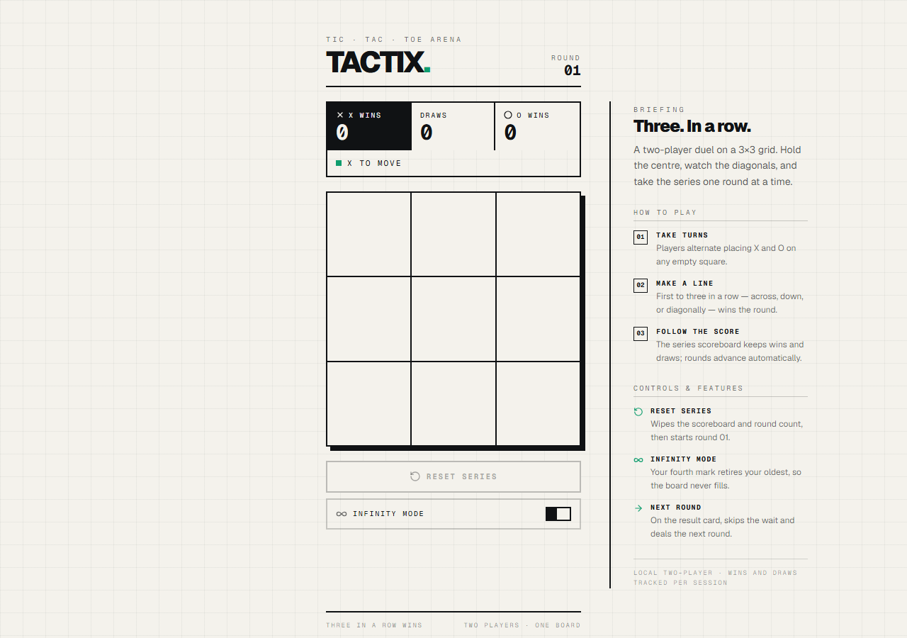

# TACTIX.

A sharp, two-player tic-tac-toe arena. Place marks on a 3×3 grid, line up three, and take the series one round at a time.

## Live game

**[Play TACTIX live →](https://tactix-next.vercel.app)**

`https://tactix-next.vercel.app`

## Screenshot

_Desktop view: the 3×3 board and scoreboard on the left, with the in-app briefing panel on the right._

## How the game works

TACTIX is a local two-player game. The board is a nine-cell array, and players alternate turns starting with **X**. After every placement the game checks all eight winning lines — three rows, three columns, and two diagonals.

- **Win** — if the latest mark completes a line, the round ends, that line turns emerald, and the winning player earns a point.
- **Draw** — if all nine cells fill with no line, the round is recorded as a draw.
- **Round flow** — the winning line is held for 0.6 seconds, then a result card announces the outcome with a confetti burst for wins. After 3.6 seconds the board clears and the next round begins automatically. The **Next round** button on the card skips the wait.
- **Series score** — wins and draws accumulate in the scoreboard for the current session. **Reset series** wipes the score and starts again at round 01.
- **Infinity mode** — after a player places their fourth mark, their oldest mark retires, so the board can never fill and games always end with three in a row.

X always opens each round, regardless of who won the previous one.

## How to play

1. Player **X** places the first mark by clicking or tapping any empty square.
2. Players alternate placing **X** and **O**.
3. The first player to line up three marks horizontally, vertically, or diagonally wins the round.
4. If the board fills with no line, the round is a draw.
5. After each round the board clears automatically and the next round starts — no setup needed.
6. Use **Reset series** to clear the scoreboard and round count at any time.
7. Toggle **Infinity mode** for longer, never-full rounds where your oldest mark retires.

## Features

- Alternating local two-player turns on a 3×3 board.
- Accurate horizontal, vertical, and diagonal win detection.
- Draw detection when the board is full.
- Live series scoreboard for X wins, O wins, and draws, with the active or winning column highlighted.
- Winning line highlighted in emerald, plus a short confetti celebration.
- Result badge card announcing the winner or draw, with automatic round advancement.
- Infinity mode with oldest-mark retirement.
- Reset series control for a fresh scoreboard.
- Sharp geometric UI with high-contrast marks, mono micro-labels, and a blueprint grid background.
- Mobile-first layout with a desktop side panel covering rules and controls.
- Screen-reader labels on cells and a polite live region for turn and result announcements.
- Reduced-motion support: confetti and entrance animations are skipped when requested.

## Functions

### Game logic — `utils/gameLogic.ts`

| Function | What it does |
| --- | --- |
| `createBoard()` | Returns a fresh nine-cell board filled with `null`. |
| `getWinner(board)` | Checks the eight winning lines and returns the winning player, line, and index; otherwise `null`. |
| `playMove(board, moves, index, player, infinite)` | Rejects occupied squares, places the mark, and applies Infinity mode retirement. Returns the next board, move list, winner, and draw state. |

### Components

| Component | Responsibility |
| --- | --- |
| `Board` | Renders the 3×3 grid and passes play events up to the page. |
| `Square` | Renders a single cell, its mark, hover preview, winning state, and accessibility label. |
| `ScoreBoard` | Displays X wins, draws, and O wins, and highlights the relevant column. |
| `Controls` | Hosts **Reset series** and the **Infinity mode** switch. |
| `InfoPanel` | Side panel with the description, how-to-play steps, and control guide. |
| `ResultModal` | Round result badge, series score, confetti, and auto-advance countdown. |

### State — `app/page.tsx`

The page owns the board, move history, current player, round number, winner/draw state, Infinity setting, and session scores. Round advancement and confetti are handled in effects so the board locks as soon as a round is decided.

Scores and the active series live in memory for the current session and reset on refresh.

## Built with

Next.js (App Router) · React · TypeScript · Tailwind CSS · lucide-react · canvas-confetti
